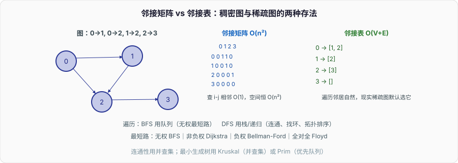

# 图：把「关系」变成能计算的结构

前面的线性表、树都是特例：链表是每个节点只有一个后继的图，树是无环连通的图。一旦允许「任意节点之间都能有边、可以成环」，就是图——社交关系、地图路网、依赖关系、状态转移，凡是「谁和谁有联系」的问题，建模出来都是图。

图本身不难，难在**选对表示法**和**认出题目是哪类图问题**。面试里图的考点很集中：邻接表还是邻接矩阵、BFS 和 DFS 各解什么、拓扑排序判环、最短路的四个算法分别在什么条件下用。把这几条理清，图的题就有了框架。



---

## 一、两种存法：矩阵还是表

图就是「顶点集 + 边集」。存边有两种主流方式，选哪个取决于图**稠不稠密**：

**邻接矩阵**：一个 `n × n` 的二维数组，`g[i][j]` 表示 i 到 j 有没有边（或边权）。查「i、j 之间有没有边」是 O(1),但无论有多少边，空间恒定 O(n²)。适合**稠密图**（边数接近 n²）和「频繁查两点间是否相邻」的场景。

**邻接表**：每个顶点挂一个链表（或 vector），存它的所有邻居。空间 O(V + E),遍历某点的邻居很自然。适合**稀疏图**（边远少于 n²，现实中的图绝大多数是稀疏的）。缺点是查「i、j 相不相邻」要遍历 i 的邻居表，O(度数)。

```cpp
// 邻接表，无权有向图
std::vector<std::vector<int>> g(n);  // g[u] 存 u 的所有邻居
void addEdge(int u, int v) {
    g[u].push_back(v);        // 有向：只加 u->v
    // 无向图再加 g[v].push_back(u);
}
```

| 维度 | 邻接矩阵 | 邻接表 |
| --- | --- | --- |
| 空间 | O(n²) | O(V+E) |
| 查 i-j 是否相邻 | O(1) | O(度数) |
| 遍历某点所有邻居 | O(n) | O(度数) |
| 适用 | 稠密图 | 稀疏图（默认选它） |

现实世界的图几乎都稀疏（一个人不会认识全世界的人），所以**默认用邻接表**。除非顶点少、边稠密、或要频繁做矩阵运算（如 Floyd）。

---

## 二、两种遍历：BFS 用队列，DFS 用栈

访问图的所有可达顶点，两种走法，它们的区别正是「栈与队列」那篇的直接应用：

- **BFS（广度优先）**：用**队列**，一层层向外平推。从起点出发，先访问所有直接邻居，再访问邻居的邻居。天然求「无权图最短路径」——第一次到达某点时的层数，就是最少边数。
- **DFS（深度优先）**：用**栈**（或递归，递归就是系统栈），一条路走到底再回退。适合「走遍所有路径」「判连通」「找环」「拓扑排序」。

两者都要一个 `visited` 数组防止重复访问和死循环（图有环，不像树能自然终止）。

```cpp
void bfs(int start, std::vector<std::vector<int>>& g) {
    std::vector<bool> visited(g.size(), false);
    std::queue<int> q;
    q.push(start); visited[start] = true;
    while (!q.empty()) {
        int u = q.front(); q.pop();
        for (int v : g[u]) {
            if (!visited[v]) {       // 第一次到 v，此时是最短路径
                visited[v] = true;   // 入队时就标记，不是出队时——否则会重复入队
                q.push(v);
            }
        }
    }
}
```

一个高频 bug：**标记 visited 的时机**。要在**入队时**标记，不是出队时。若出队才标记，同一个点可能被多个邻居重复塞进队列，轻则变慢、重则爆队列。

BFS 求最短路只对**无权图（每条边权重都是 1）**成立。边有权重时，「边数最少」不等于「总权重最小」,就得上 Dijkstra。

---

## 三、拓扑排序：给有向无环图排个能执行的顺序

一堆任务有先后依赖（A 完成才能做 B），求一个合法的执行顺序，这就是**拓扑排序**，只对**有向无环图（DAG）**有意义。编译依赖、任务调度、课程先修、Maven/Gradle 构建顺序，全是它。

标准做法是 **Kahn 算法（BFS 版）**：

1. 统计每个节点的**入度**（有多少条边指向它）。
2. 所有入度为 0 的节点入队（它们没有前置依赖，可以先做）。
3. 反复出队一个节点、加入结果，把它指向的节点入度各减 1；减到 0 的入队。
4. 若最终结果里的节点数 < 总节点数，说明**有环**——环上的节点入度永远减不到 0，进不了队。

所以拓扑排序**顺带判环**：排不出完整序列就是有环。这正是「检测循环依赖」的标准手段——Spring 检测 Bean 循环依赖、构建工具检测模块环，本质都是拓扑排序失败。DFS 也能做拓扑排序（按「后序完成时间」逆序），并用「递归栈上是否重复访问」判环。

---

## 四、最短路：四个算法，四个适用条件

最短路是图算法里最容易记混的一块。记住「什么条件用什么」，比记实现更重要：

- **BFS**：无权图（或所有边权相同）。O(V+E)。第一次到达即最短。
- **Dijkstra**：**边权非负**的单源最短路。用优先队列每次取「当前距离最小的未确定节点」,贪心地确定它的最短距离。O(E log V)。**不能处理负权边**——负权会让「已确定的点」被后来的负边更新，贪心前提崩塌。
- **Bellman-Ford**：**允许负权边**的单源最短路，还能**检测负权环**。对所有边松弛 V-1 轮；若第 V 轮还能松弛，说明有负权环。O(V·E),比 Dijkstra 慢，但能处理负权。
- **Floyd-Warshall**：**多源**最短路（任意两点间）。三重循环 DP，O(V³)。顶点少、要全对全距离时用，也能处理负权（无负环）。

Dijkstra 的核心是优先队列（见「堆与优先队列」）：

```cpp
// 邻接表 g[u] = {(v, w)...}，返回 start 到各点最短距离
std::vector<int> dijkstra(int start, std::vector<std::vector<std::pair<int,int>>>& g) {
    std::vector<int> dist(g.size(), INT_MAX);
    std::priority_queue<std::pair<int,int>,
        std::vector<std::pair<int,int>>, std::greater<>> pq; // 小顶堆：(距离, 点)
    dist[start] = 0; pq.push({0, start});
    while (!pq.empty()) {
        auto [d, u] = pq.top(); pq.pop();
        if (d > dist[u]) continue;          // 惰性删除：过期的旧记录跳过
        for (auto [v, w] : g[u]) {
            if (dist[u] + w < dist[v]) {     // 松弛
                dist[v] = dist[u] + w;
                pq.push({dist[v], v});
            }
        }
    }
    return dist;
}
```

那句 `if (d > dist[u]) continue;` 是标准库堆不支持 decrease-key 的绕法（见「堆与优先队列」）：不去修改堆里的旧记录，而是任由重复入队，取出时发现距离已经比记录的大就丢弃。

---

## 五、并查集与最小生成树：另一类图问题

不是所有图问题都靠遍历。**并查集（Union-Find）**专门回答「这两个点连通吗」「有几个连通分量」,用「森林 + 路径压缩 + 按秩合并」把 union 和 find 做到近乎 O(1)（严格是反阿克曼函数 α，实践中 ≤ 4）。判环、朋友圈数量、动态连通性都是它。

**最小生成树（MST）**：用最少的总权重把所有点连通。两个经典算法：

- **Kruskal**：把边按权重排序，从小到大加入，用**并查集**判「加这条边会不会成环」,不成环就要。适合稀疏图。
- **Prim**：从一个点出发，每次用**优先队列**取「连接已选集合的最小边」,像 Dijkstra 一样长树。适合稠密图。

可以看到：MST 又把并查集、堆、排序缝在了一起——图算法往往是前面所有基础结构的综合应用。

---

## 六、面试收口

- **邻接矩阵还是邻接表？** 稠密图或频繁查相邻用矩阵 O(n²)；稀疏图（现实默认）用邻接表 O(V+E)。
- **BFS 和 DFS 分别解什么？** BFS 用队列、求无权图最短路、层序；DFS 用栈/递归、判连通、找环、拓扑排序。visited 要在入队时标记。
- **怎么检测循环依赖？** 拓扑排序（Kahn 算法），排不出完整序列即有环；只适用于 DAG。
- **最短路怎么选？** 无权 BFS；非负权 Dijkstra（O(E log V)，不能负权）；有负权 Bellman-Ford（能检测负环）；全对全 Floyd（O(V³)）。
- **判连通/最小生成树用什么？** 连通性用并查集（近 O(1)）；MST 用 Kruskal（并查集 + 排序）或 Prim（优先队列）。

图是数据结构的集大成者：它的表示靠数组和链表，遍历靠栈和队列，Dijkstra/Prim 靠堆，Kruskal 靠并查集和排序。把这一篇和前面几篇连起来看，基础数据结构就成了一张网，而不是一堆孤立名词。
