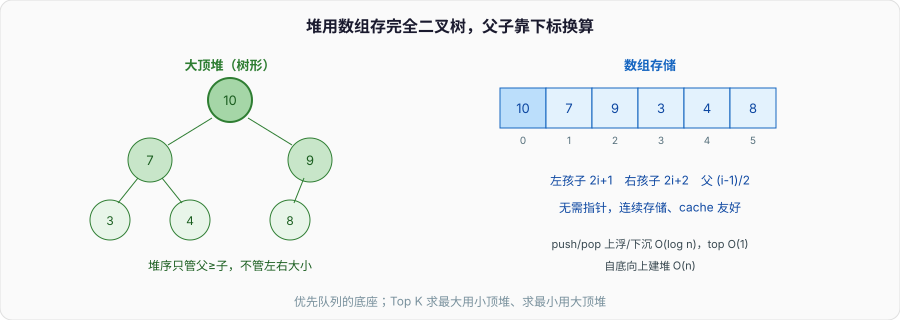

# 堆与优先队列：用数组假装一棵树，只保证「最值在顶」

普通队列先进先出，可很多场景要的是「先出最重要的」：任务按优先级调度、Dijkstra 每次取最近节点、求 Top K。这要一个结构，能反复以低成本拿出当前最大（或最小）值，还能不断塞新值进去。**堆**就是干这个的——它是优先队列几乎唯一的底层实现。

堆的精妙在于：它是一棵**完全二叉树**，却**不用指针、直接存在数组里**。理解「数组下标怎么当树用」和「上浮下沉怎么维持堆序」，堆就通了。面试考点集中在：堆和 BST 的区别、建堆为什么是 O(n) 而不是 O(n log n)、以及 Top K 该用大顶堆还是小顶堆。



---

## 一、堆序：只管父子，不管左右

堆有两个约束，缺一不可：

1. **结构上是完全二叉树**——除最后一层外都填满，最后一层从左往右排。这保证树高恒为 O(log n)，也让它能紧凑地塞进数组。
2. **堆序**——大顶堆里每个节点 ≥ 它的两个孩子；小顶堆反之。注意堆序**只约束父子**，不约束兄弟、不约束左右大小。

第 2 点是堆和二叉搜索树最大的区别，也是最常被搞混的地方：**BST 是「左 < 根 < 右」的全局有序，能 O(log n) 查任意值；堆只保证「根是最值」，查一个任意值要 O(n)。** 堆放弃了「整体有序」，换来「拿最值极快、维护极便宜」。要问「堆里有没有某个数」，堆并不比无序数组强——它压根不是为查找造的。

---

## 二、数组当树：下标算术代替指针

完全二叉树按层从上到下、从左到右编号，塞进数组，父子关系就变成纯粹的下标算术。以 0 为根：

- 节点 `i` 的左孩子：`2*i + 1`
- 节点 `i` 的右孩子：`2*i + 2`
- 节点 `i` 的父亲：`(i - 1) / 2`

于是根本不需要 `left`/`right` 指针，省掉每节点两个指针的内存，还因为连续存储而 cache 友好。这是「用数组假装一棵树」的全部魔法——它成立的前提正是「完全二叉树没有空洞」，所以下标是连续的、公式才对得上。普通二叉树有空洞，用这套下标会浪费大量空位，才需要指针。

```cpp
class MaxHeap {
    std::vector<int> h;
    void up(int i) {                    // 上浮：和父亲比，大了就换上去
        while (i > 0 && h[i] > h[(i-1)/2]) {
            std::swap(h[i], h[(i-1)/2]);
            i = (i-1)/2;
        }
    }
    void down(int i) {                  // 下沉：和较大的孩子比，小了就换下去
        int n = h.size();
        while (2*i + 1 < n) {
            int c = 2*i + 1;            // 左孩子
            if (c + 1 < n && h[c+1] > h[c]) ++c; // 取较大的孩子
            if (h[i] >= h[c]) break;
            std::swap(h[i], h[c]);
            i = c;
        }
    }
public:
    void push(int x) { h.push_back(x); up(h.size()-1); }  // 塞到末尾再上浮
    int  top() const { return h[0]; }                     // 最值恒在下标 0
    void pop() {                                          // 弹最值
        h[0] = h.back(); h.pop_back();                    // 末尾顶到根
        if (!h.empty()) down(0);                          // 再下沉复位
    }
};
```

---

## 三、执行走查：push 之后的上浮

大顶堆当前是 `[9, 7, 8, 3, 4]`（合法：9≥7,8；7≥3,4）。`push(10)`：

| 步骤 | 数组 | 说明 |
| --- | --- | --- |
| 1 追加到末尾 | `[9,7,8,3,4,10]` | 10 在下标 5 |
| 2 和父 `(5-1)/2=2`（值 8）比 | 10 > 8，交换 | `[9,7,10,3,4,8]`,i=2 |
| 3 和父 `(2-1)/2=0`（值 9）比 | 10 > 9，交换 | `[10,7,9,3,4,8]`,i=0 |
| 4 到根，停 | `[10,7,9,3,4,8]` | 10 上浮到顶，堆序恢复 |

新元素总是「先塞末尾（维持完全二叉树），再沿着到根的路径上浮」。上浮只走一条从叶到根的路径，路径长就是树高 O(log n)。`pop` 对称：把末尾元素顶到根、砍掉尾巴、再下沉。所以 `push` 和 `pop` 都是 **O(log n)**,`top` 是 O(1)。

**改一步验证：**若 `pop` 时不是「末尾顶到根再下沉」，而是「直接把根的某个孩子提上来」,会破坏完全二叉树的结构（中间出现空洞），下标公式立刻失效。必须用末尾元素补根，才能保住「数组连续」这个地基。

---

## 四、建堆为什么是 O(n)

给一个乱序数组，原地建堆有两种思路：

- **逐个 push**：n 次 O(log n),总 O(n log n)。
- **自底向上 heapify**：从最后一个非叶节点 `(n/2 - 1)` 开始，倒着对每个节点做 `down`。这是 **O(n)**。

O(n) 反直觉——n 个节点各做一次 down 不该是 O(n log n) 吗？关键在**大部分节点很矮**：叶子（约 n/2 个）高度 0，不用动；高度 1 的约 n/4 个；越往上节点越少。下沉代价是高度，总代价是 `Σ(每层节点数 × 该层高度) = n × Σ(h/2^h)`,而 `Σ h/2^h` 收敛到常数 2，所以总和是 O(n)。「大量矮节点 + 极少高节点」让求和收敛，这是堆排序建堆阶段能做到线性的原因。

堆排序就是它的应用：先 O(n) 建大顶堆，再反复「取根（最大）放数组末尾，剩下的 down 复位」,n 次 O(log n) 得到有序序列。整体 O(n log n)、原地、不稳定（见「十大排序」）。

---

## 五、Top K：堆最实用的场景，也最容易选反

「从海量数据里求最大的 K 个」是堆的招牌题。直觉会想「求最大 K 个，用大顶堆」——**错，要用小顶堆，且只维持 K 个元素**：

- 维护一个大小为 K 的**小顶堆**，堆顶是这 K 个里最小的。
- 新元素来，若比堆顶大，就替掉堆顶再下沉；否则丢弃。
- 扫完，堆里就是最大的 K 个，堆顶是第 K 大。

为什么用小顶堆？因为要频繁「淘汰当前 K 个里最小的那个」,小顶堆的堆顶正好是最小值，O(1) 拿到、O(log K) 换掉。复杂度 O(n log K),空间 O(K)——数据量 n 上亿、K 才几百时，这比「全部排序 O(n log n)」省得多，也不用把数据全装进内存。

反过来「求最小的 K 个」用大顶堆。记法：**求 Top 大用小顶堆，求 Top 小用大顶堆**,堆顶始终是「最容易被淘汰的那个」。选反了会退化或结果错误，这是面试高频陷阱。

数据流求中位数则用「大顶堆 + 小顶堆」对顶：大顶堆存较小一半、小顶堆存较大一半，中位数就在两个堆顶之间。这是堆的组合拳。

---

## 六、优先队列在工程里

- **`std::priority_queue`（C++）默认大顶堆**，要小顶堆得传 `greater` 比较器——很多人踩「怎么默认是大顶」的坑。Java `PriorityQueue` 默认小顶堆，正好相反，跨语言时要留神。
- **Dijkstra / Prim** 每次取「当前距离最小的节点」,优先队列是标配，把最短路从 O(V²) 优化到 O(E log V)（见「图」）。
- **任务调度 / 定时器**：按到期时间建小顶堆，堆顶就是「下一个该触发的」。时间轮是它在高并发下的替代方案。
- **合并 K 个有序链表**：每条链的当前头进小顶堆，每次取最小接上、再把它的后继入堆，O(N log K)。

一个工程注意点：标准库的堆**不支持高效地「修改/删除任意元素」**（只能碰堆顶）。Dijkstra 里节点距离变小需要「decrease-key」,标准 `priority_queue` 做不到，常用「惰性删除」（旧的留着，取出时判过期跳过）绕过，或换支持 decrease-key 的索引堆/斐波那契堆。

---

## 七、面试收口

- **堆和 BST 的区别？** 堆只保证「根是最值」，查任意值 O(n)；BST 全局有序，查任意值 O(log n)。堆为「取最值 + 维护便宜」而生。
- **堆为什么能用数组？** 完全二叉树无空洞，父子关系是下标算术（`2i+1`/`2i+2`/`(i-1)/2`），省指针、cache 友好。
- **push/pop/top 复杂度？** push、pop 都 O(log n)（上浮/下沉走一条到根的路径），top O(1)。
- **建堆为什么 O(n)？** 大量节点很矮，`Σ h/2^h` 收敛到常数，总代价线性。
- **Top K 用什么堆？** 求最大 K 个用大小为 K 的**小顶堆**（堆顶是最易淘汰的最小值），O(n log K)、空间 O(K)。求最小 K 个反过来用大顶堆。

堆是「完全二叉树 + 数组存储」的产物，接着看「图」里 Dijkstra 怎么用它把最短路优化到 O(E log V)，那是优先队列在算法里最漂亮的一次登场。
