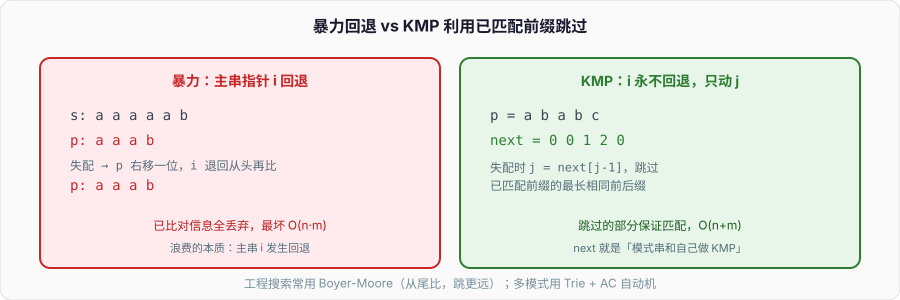

# 字符串匹配：为什么 KMP 不用回退主串

在一段文本里找一个模式串出现的位置，是最古老也最常考的字符串问题。`std::string::find`、`indexOf`、编辑器的 Ctrl+F、grep，底层都要解决它。暴力法谁都会写，但它最坏 O(n·m);面试真正考的是：**为什么暴力慢、KMP 靠什么把它降到 O(n+m)、那个 next 数组到底是什么**。

KMP 是很多人「背过但讲不清」的算法。这篇不背代码，而是把它的核心洞察讲透：**匹配失败时，已经比对过的那段字符本身就告诉了你该往哪跳，主串指针根本不用回退。**



---

## 一、暴力法慢在哪

暴力匹配：模式串 `p` 对齐文本 `s` 的每个位置，逐字符比。一旦不匹配，就把 `p` 右移一位，**从头再比**——关键在这个「从头再比」，它把之前比对的信息全扔了。

```text
s: a a a a a b
p: a a a b
```

在 `s[3]` 处失配（`s` 是 a、`p` 是 b……其实这里前三个 a 都匹配，第四位 s=a、p=b 失配）。暴力法把 `p` 右移一位，从 `s[1]` 重新比。可我们**明明已经知道** `s[1..3]` 是 `aaa`,这些信息刚才比过了，却要重比。最坏情况（如 `s=aaaa...a`, `p=aaa...b`）每个位置都要比几乎整个 `p`,总共 O(n·m)。

浪费的本质是：**主串指针 i 发生了回退**（从 3 退回 1）。KMP 的全部目标就是——**让 i 永不回退**,只动模式串指针 j。

---

## 二、KMP 的洞察：已匹配的前缀里藏着答案

假设 `p` 的前 `j` 个字符已经和 `s` 匹配，在第 `j` 位失配。暴力法把 `p` 挪一位重来;KMP 问一个更聪明的问题：**已经匹配的这段 `p[0..j-1]`,它的「最长相同前后缀」有多长？** 

「相同前后缀」是指：一个字符串的前缀和后缀相等（不含它自己）。比如 `abcab` 的前缀 `ab` 和后缀 `ab` 相等，最长相同前后缀长度是 2。

它凭什么有用？失配时，`p[0..j-1]` 这段已经和 `s` 里对应的一段完全相同。如果这段有长为 `k` 的相同前后缀，意味着「这段的后 `k` 个字符」等于「前 `k` 个字符」，而后 `k` 个字符正贴着失配点。所以我们可以**直接把 `p` 滑过去，让前 `k` 个字符对齐到刚才后 `k` 个的位置**,这 `k` 个字符不用重比——它们必然匹配。`j` 从失配位置跳到 `k`,而 `i` 一动不动。

这就是「不回退主串」的原理：**失配时，模式串已匹配部分的最长相同前后缀，告诉你模式串该跳到哪，跳过的部分保证匹配。** next 数组存的就是「每个位置对应的最长相同前后缀长度」。

---

## 三、next 数组：模式串跟自己比对

next（有的教材叫 fail、π 函数）只和模式串有关，和文本无关，可以预处理。`next[j]` = `p[0..j]` 的最长相同前后缀长度。构造它本身就是一次「模式串和自己做 KMP」：

```cpp
std::vector<int> buildNext(const std::string& p) {
    int m = p.size();
    std::vector<int> next(m, 0);
    int k = 0;                       // k：当前最长相同前后缀长度
    for (int i = 1; i < m; ++i) {
        while (k > 0 && p[i] != p[k]) // 失配就回退到更短的前后缀
            k = next[k-1];
        if (p[i] == p[k]) ++k;        // 匹配上，前后缀长度 +1
        next[i] = k;
    }
    return next;
}
```

`while (k > 0 && p[i] != p[k]) k = next[k-1];` 是整个 KMP 最难的一行：当扩展失败，不是把 `k` 归零重来，而是**回退到「次长的相同前后缀」继续试**——因为 `next[k-1]` 正是 `p[0..k-1]` 的最长相同前后缀，是下一个可能匹配的候选。这一步的连续回退，均摊下来使构造是 O(m)。

拿 `p = "ababc"` 走一遍：

| i | p[i] | 比对过程 | k | next |
| --- | --- | --- | --- | --- |
| 0 | a | 初始 | - | 0 |
| 1 | b | p[1]≠p[0] | 0 | 0 |
| 2 | a | p[2]==p[0] | 1 | 1 |
| 3 | b | p[3]==p[1] | 2 | 2 |
| 4 | c | p[4]≠p[2]→k=next[1]=0；p[4]≠p[0] | 0 | 0 |

`next = [0,0,1,2,0]`。读它：到 `abab`（i=3）时最长相同前后缀是 `ab`(长 2);到 `ababc` 时因为 c 破坏了，回退到 0。

---

## 四、主匹配：i 从不回头

有了 next，主匹配几乎和构造 next 一模一样——因为构造 next 本就是「p 匹配 p」：

```cpp
int kmp(const std::string& s, const std::string& p) {
    auto next = buildNext(p);
    int j = 0;                        // 模式串已匹配长度
    for (int i = 0; i < (int)s.size(); ++i) {  // 注意：i 只增不减
        while (j > 0 && s[i] != p[j])  // 失配，模式串按 next 回退
            j = next[j-1];
        if (s[i] == p[j]) ++j;
        if (j == (int)p.size())        // 完全匹配
            return i - j + 1;          // 匹配起点
    }
    return -1;
}
```

`i` 在整个 for 循环里**只增不减**,这就是「主串不回退」的落地。`j` 会因失配而回退，但每次回退都是跳到 next 指示的位置，跳过的字符保证匹配。`i` 走一遍 n、`j` 的总回退量被总增量封顶（均摊），所以主匹配 O(n),加上构造 O(m),总 **O(n+m)**。

**改一行验证：**若把失配处理写成 `j = 0`(暴力式归零) 而不是 `j = next[j-1]`,算法退化回暴力 O(n·m),而且因为 i 不回退，还会**漏掉匹配**——归零丢掉了「已匹配前缀里可复用的部分」。next 回退和 i 不回退是配套的，改一个就全错。

---

## 五、除了 KMP 还有谁

KMP 是理解「利用已比对信息」的入门，但工程里的字符串搜索常用别的：

- **Boyer-Moore**：从模式串**尾部**往前比，利用「坏字符」和「好后缀」规则大跨步跳过，实际文本搜索常比 KMP 快，是 grep、many `strstr` 实现的选择。它的直觉是「越长的模式串，一次能跳得越远」,与 KMP 相反的方向。
- **Rabin-Karp**：用**滚动哈希**把模式串和文本窗口都算成哈希值，哈希相等再逐字符确认。适合**多模式匹配**（同时找多个串）和二维匹配。哈希冲突时要回退确认，最坏仍 O(n·m),但平均 O(n+m)。
- **Trie（字典树）+ AC 自动机**：一次性在文本里找**大量**模式串（敏感词过滤、多关键词）。AC 自动机是「Trie 上的 KMP」——把 next 数组的思想搬到树上，失配时沿 fail 指针跳。
- **后缀自动机 / 后缀数组**：处理「同一文本、大量不同查询」（最长重复子串、不同子串个数），把预处理做在文本上。

选择逻辑：找一次短模式，`std::string::find`（多数实现是暴力或 BM 变体）够用;找一个模式且理解成本可接受，KMP;找海量模式，Trie/AC 自动机;同一文本反复查，后缀结构。

---

## 六、面试收口

- **暴力法慢在哪？** 失配时主串指针 i 回退、已比对信息全丢，最坏 O(n·m)。
- **KMP 的核心洞察？** 失配时，已匹配前缀的「最长相同前后缀」告诉模式串该跳到哪，跳过的部分保证匹配，主串 i 永不回退。
- **next 数组是什么？** `next[j]` = `p[0..j]` 的最长相同前后缀长度；它是「模式串和自己做 KMP」的产物，O(m) 构造。
- **KMP 复杂度？** O(n+m)。i 只增，j 的总回退被总增量封顶（均摊）。
- **工程里为什么常用 Boyer-Moore？** 从尾部比、坏字符/好后缀能大跨步跳，模式串越长跳越远，实测常快于 KMP;多模式匹配则用 Trie/AC 自动机。

字符串匹配把「预处理换查询」的思想推到极致：花 O(m) 把模式串的结构（相同前后缀）算清楚，就能让查询阶段不走回头路。Trie 和 AC 自动机把这套思想搬上树，那又回到了「图/树」的遍历——基础结构在这里再次交汇。
