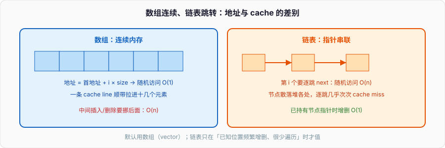

# 数组与链表：连续内存与指针跳转，一切线性结构的两个原型

栈、队列、哈希表、图的邻接表、甚至 B+ 树的叶子链，底层几乎都是这两样东西拼出来的：一块连续内存，或者一串靠指针串起来的节点。把这两者的取舍讲透，后面的结构就都是它们的组合与变形。

面试问「数组和链表的区别」，只答「一个连续一个不连续」拿不到分。真正要说清的是：为什么数组随机访问是 O(1) 而链表是 O(n)、为什么链表「插入 O(1)」这句话有前提、动态数组扩容凭什么还能算 O(1)、以及 CPU 缓存怎么让「理论复杂度相同」的两种写法差出几十倍。



---

## 一、地址怎么来的：随机访问的本质

数组是一块连续内存。声明 `int a[8]`，编译器拿到的是首地址，第 `i` 个元素的地址就是 `首地址 + i * sizeof(int)`。一次乘加算出地址，一次访存拿到值——这就是随机访问 O(1) 的全部内容，和数组多长没关系。

链表没有这个公式。`node->next` 只知道下一个节点在哪，要拿第 `i` 个，只能从头 `next` 跳 `i` 次。跳转的地址是运行时才知道的，编译器算不出来。所以链表的「随机访问」是 O(n)，本质是**地址不可计算**，不是「慢一点」。

```cpp
struct ListNode {
    int val;
    ListNode* next;
    ListNode(int v) : val(v), next(nullptr) {}
};
```

一个节点在 64 位机上：`int val` 4 字节 + 对齐填充 4 字节 + `next` 指针 8 字节 = 16 字节。存一个 `int` 要付 16 字节，其中 12 字节是「结构开销」。数组存 8 个 `int` 就是 32 字节，紧挨着。这个差别不只是省内存，下面会看到它直接决定缓存命中。

---

## 二、增删：O(1) 这句话的前提

「链表插入删除 O(1)，数组 O(n)」是半句话。完整版本是：

- **数组在中间插入/删除是 O(n)**，因为要把后面的元素整体挪位。在末尾追加（不扩容时）是 O(1)。
- **链表插入/删除节点本身是 O(1)**——但前提是**你已经拿到了那个位置的指针**。如果只给你一个下标或一个值，得先 O(n) 找过去，找的这一步把 O(1) 吃掉了。

所以链表真正比数组快的场景是：**你手上已经有节点指针，要在它旁边增删**。LRU 缓存把节点指针存在哈希表里，删除时 O(1) 摘链，就是吃这个红利；反过来「删除链表里第 k 个」并不比数组占便宜。

数组中间删除，挪动是逃不掉的：

```
删除下标 2（值 30），后面每个往前挪一格
[10,20,30,40,50]  →  [10,20,40,50,_]
                        ↑ 40、50 各挪一次，O(n)
```

有一个常被忽略的技巧：如果**不要求保持顺序**，数组删除可以 O(1)——把最后一个元素搬到被删位置，再砍掉尾巴。这在「集合语义」的场景（不在乎次序）里很常用。

---

## 三、动态数组：扩容为什么还能算 O(1)

`std::vector`、Java `ArrayList`、Go 的 slice 都是「动态数组」：底层还是连续内存，装满了就申请一块更大的、把旧数据拷过去、释放旧的。单次扩容是 O(n) 拷贝，可 `push_back` 平均却是 O(1),这靠的是**倍增 + 均摊**。

设每次满了扩成原来的 2 倍。从 0 push 到 n 个，触发的拷贝总量是 `1 + 2 + 4 + ... + n ≈ 2n`,是 O(n) 的总拷贝分摊到 n 次插入，每次均摊 O(1)。若改成「每次 +1」扩容，总拷贝是 `1+2+...+n = O(n²)`,均摊就退化成 O(n)——这就是为什么增长因子必须是「乘」不是「加」。

| 增长策略 | n 次 push 总拷贝 | 均摊单次 |
| --- | --- | --- |
| ×2（或 ×1.5） | O(n) | O(1) |
| +1（固定增量） | O(n²) | O(n) |

倍数取 2 还是 1.5 有讲究：1.5 倍的好处是「释放的旧块有机会被后续更大的申请复用」（几次之后累计释放的空间可能凑得出下一次的需求），内存碎片友好，GCC 的 libstdc++ vector 用 2 倍，MSVC 用 1.5 倍，都是工程取舍，不影响均摊 O(1) 的结论。

一个高频坑：**扩容会让所有指向元素的指针/引用/迭代器失效**，因为底层内存换了地方。`vector` 里存了元素地址、又在循环里 `push_back`,是经典 use-after-free。`reserve` 预留容量能避免中途扩容，也能避免这类失效。链表没有这个问题——节点地址一旦分配就不动。

---

## 四、缓存：把「复杂度相同」拉开几十倍的东西

CPU 访问内存不是一次取一个字节，是一次取一整条 **cache line**（常见 64 字节）。数组连续存放，取第一个元素时，它后面的十几个元素被顺带拉进缓存，接着遍历几乎全部命中。链表节点是 `new` 出来的，散落在堆各处，每跳一个 `next` 大概率是一次 cache miss，要去主存等几十到上百个周期。

所以「遍历一个数组」和「遍历一个等长链表」，理论都是 O(n),实测数组常常快一个数量级。这也是为什么工程里**默认容器是数组（`vector`），而不是链表**。链表只在「频繁在已知位置增删、且很少遍历」时才值得。

顺带一个反直觉结论：在现代 CPU 上，「在有序数组中间插入」即使要挪 O(n) 个元素，也常常比「维护一个有序链表逐个 `next` 找插入点」更快——因为挪动是连续内存的顺序拷贝，硬件预取喜欢它;而链表找位置是一串随机跳转。别只按大 O 选结构，也要看访问模式是不是顺序的。

---

## 五、执行走查：反转单链表

链表题的地基是「反转」。给 `1 -> 2 -> 3 -> null`,原地反成 `3 -> 2 -> 1 -> null`。核心是三个指针来回倒手，一次改一根 `next`。

```cpp
ListNode* reverse(ListNode* head) {
    ListNode* prev = nullptr;
    ListNode* cur  = head;
    while (cur) {
        ListNode* next = cur->next; // 1. 先存住后继，否则改完就丢
        cur->next = prev;           // 2. 当前节点掉头指向前驱
        prev = cur;                 // 3. prev 前移
        cur  = next;                // 4. cur 前移
    }
    return prev; // cur 走到 null 时，prev 是新头
}
```

拿 `1 -> 2 -> 3` 走一遍，看每行执行后的状态：

| 迭代 | next | 执行 `cur->next=prev` 后的链 | prev | cur |
| --- | --- | --- | --- | --- |
| 进入前 | - | 1→2→3→∅ | ∅ | 1 |
| 第 1 轮 | 2 | 1→∅（2→3 仍在） | 1 | 2 |
| 第 2 轮 | 3 | 2→1→∅ | 2 | 3 |
| 第 3 轮 | ∅ | 3→2→1→∅ | 3 | ∅ |
| 退出 | - | 返回 prev=3 | - | - |

第一行 `next = cur->next` 是整段的命门：一旦先执行了 `cur->next = prev`,原来的后继就再也找不到了。**改一行验证：**把前两句顺序调换（先 `cur->next=prev` 再 `next=cur->next`），第一轮之后 `next` 拿到的就是 `prev`（走回头），链表从此断裂成环或丢尾。链表题几乎所有 bug 都出在「改指针的顺序」和「改之前有没有存住要用的指针」。

---

## 六、双链表、循环链表、哨兵

单链表只能往后走，删一个节点得知道它的**前驱**，所以「只给待删节点指针、要求 O(1) 删除」在单链表上做不到（除非把后继的值拷过来再删后继，这是 trick）。**双链表**每个节点多存一个 `prev`,拿到任意节点就能 O(1) 摘除，代价是每节点多一个指针、每次增删多维护一根链。LRU、`std::list`、内核的 `list_head` 都是双向循环链表。

**哨兵节点（dummy head）**是链表工程的标配：在真正的头前面挂一个不存数据的假节点。好处是「删头节点」和「删中间节点」变成同一套代码，不用为「被删的是不是头」写特判。写链表题时先加一个 `dummy->next = head`,返回 `dummy->next`,能消掉一大半边界 bug。

**循环链表**把尾节点的 `next` 指回头（双向的话头的 `prev` 指向尾），适合「轮转」语义：约瑟夫环、时间轮、round-robin 调度。判空和遍历终止条件从「`next == null`」变成「`next == head`」，是常见改错点。

---

## 七、对应到语言和工程

| 需求 | C++ | Java | 说明 |
| --- | --- | --- | --- |
| 默认线性容器 | `std::vector` | `ArrayList` | 连续内存，随机访问 O(1)，遍历 cache 友好 |
| 两端进出 | `std::deque` | `ArrayDeque` | 分段数组，不是链表；头尾 O(1) |
| 频繁中间增删（有指针） | `std::list` | `LinkedList` | 双链表；实际很少用，遍历慢 |

几条工程经验：

- `std::vector` 是 90% 场景的正确默认。`std::list` 教科书地位高，生产里因为 cache 不友好、每节点一次 `new`,大多数时候反而更慢，用之前先问「我真的会在已知位置频繁增删、且很少遍历吗」。
- Java 的 `LinkedList` 同理，`ArrayList` 几乎总是更好；`LinkedList` 唯一略有优势的是「当队列用」，但那也不如 `ArrayDeque`。
- `deque`（双端队列）常被误当成链表，它其实是「一段段连续数组 + 索引块」，随机访问也接近 O(1)，两端增删 O(1)，是「既要数组的遍历性能、又要两端进出」的折中。
- Go 的 slice 是动态数组，`append` 触发扩容时底层数组会换地址，多个 slice 共享底层数组时的「一个 append 改了另一个」是同一类扩容陷阱。

---

## 八、面试收口

- **随机访问谁快？** 数组 O(1)（地址可算），链表 O(n)（必须逐跳）。
- **插入删除谁快？** 链表在「已持有节点指针」时 O(1)；否则要先 O(n) 找，不占便宜。数组中间增删 O(n)，末尾均摊 O(1)。
- **动态数组为什么均摊 O(1)？** 倍增扩容，n 次插入总拷贝 O(n)。固定增量会退化成 O(n²)。
- **理论一样为什么实测差很多？** cache line + 预取，数组顺序遍历命中率高，链表逐跳几乎次次 miss。
- **链表高频题的套路：** 哨兵节点消边界、快慢指针找环/找中点、三指针反转、双链表 + 哈希做 LRU。快慢指针找环见下一层：`slow` 每次一步、`fast` 每次两步，相遇即有环，再从头和相遇点同速前进，相遇处是环入口。

数组承上启下：`std::vector` 是栈和邻接表的底座，见「栈与队列」和「图」；数组 + 哈希函数是哈希表的直接实现，见「哈希表」；数组按完全二叉树下标规则解释就是堆，见「堆与优先队列」。
