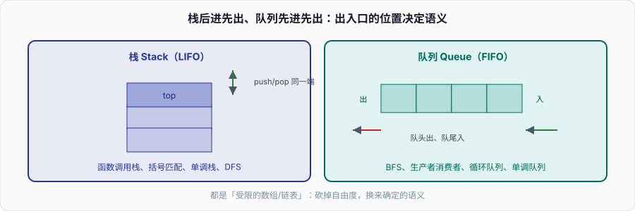

# 栈与队列：两种受限的线性表，约束换来的秩序

栈和队列不是新的存储结构，它们就是数组或链表，只不过**故意限制了出入口**：栈只准在一端进出（后进先出），队列在一端进、另一端出（先进先出）。把自由的线性表砍成只剩一两个操作，反而换来了确定的语义——函数调用、表达式求值、BFS、生产者消费者，全靠这两种约束撑起来。

面试常问的不是「什么是栈」，而是：递归和栈是什么关系、为什么循环队列要留一个空位、单调栈凭什么把 O(n²) 压到 O(n)、以及阻塞队列在并发里怎么当生产者消费者的枢纽。



---

## 一、栈：只有一个口

栈只暴露三个操作：`push`（压入）、`pop`（弹出）、`top`（看栈顶）。都发生在同一端，所以**后进先出（LIFO）**。用数组实现最自然：一个 `top` 下标指向栈顶，`push` 就 `data[++top]=x`,`pop` 就 `top--`,全是 O(1)。

```cpp
class Stack {
    std::vector<int> data;
public:
    void push(int x) { data.push_back(x); }
    void pop()       { data.pop_back(); }   // 空栈 pop 是未定义行为，调用前要判空
    int  top() const { return data.back(); }
    bool empty()const { return data.empty(); }
};
```

为什么用数组而不是链表？栈只在一端动，数组末尾 `push_back`/`pop_back` 均摊 O(1),又 cache 友好，几乎没有理由用链表栈。`std::stack` 默认底层就是 `deque`,也可以换成 `vector`。

**栈最重要的身份是「函数调用栈」。** 每次调用函数，运行时压入一个栈帧：返回地址、参数、局部变量、保存的寄存器。函数返回就弹出栈帧，控制权和现场按 LIFO 精确回到调用点。递归之所以能工作，是因为每层递归是一个独立栈帧，互不干扰;递归太深爆的 `StackOverflow` / 段错误，就是这个栈撞到了守卫页（见「虚拟内存」）。

由此推出一个常考结论：**任何递归都能改写成「显式栈 + 循环」**。编译器做尾递归优化、我们手动把 DFS 改成栈迭代，本质都是把「系统调用栈」搬成「自己管理的数据栈」，避免深递归爆栈。

---

## 二、栈的两个杀手锏：括号匹配与单调栈

**括号匹配 / 表达式求值。** 左括号入栈，右括号来了就弹出栈顶配对，结束时栈空才合法。这类「就近配对、后开先闭」的问题天然是栈：编译器解析嵌套、JSON 校验、计算器把中缀转后缀再求值，全是它。

**单调栈**是把栈从「配对」升华成「找关系」的技巧，专治「下一个更大/更小元素」这类问题。维护一个栈，保持栈内元素单调（比如递减），新元素进来前，把栈里所有比它小的弹出——被弹出的元素，就找到了它右边第一个更大的数（就是当前这个新元素）。

```cpp
// 每个元素右边第一个更大元素的下标，没有则 -1
std::vector<int> nextGreater(std::vector<int>& a) {
    int n = a.size();
    std::vector<int> res(n, -1);
    std::stack<int> st; // 存下标，栈内对应值单调递减
    for (int i = 0; i < n; ++i) {
        while (!st.empty() && a[st.top()] < a[i]) {
            res[st.top()] = i; // a[i] 就是 st.top() 右边第一个更大的
            st.pop();
        }
        st.push(i);
    }
    return res;
}
```

为什么是 O(n)？每个下标**最多入栈一次、出栈一次**,内层 `while` 看着像嵌套循环，但所有元素的出栈次数加起来不超过 n。这是典型的均摊分析：单看某次 `while` 可能弹很多，但全局总弹出量被入栈量封顶。柱状图接雨水、股票跨度、每日温度，都是这一个模板换皮。

---

## 三、队列：一端进，另一端出

队列是 `enqueue`（队尾入）、`dequeue`（队头出），**先进先出（FIFO）**。用链表实现干净：维护 `head` 和 `tail` 两个指针，队头出、队尾入都是 O(1)。用数组实现就要小心——如果队头固定在下标 0，出队要把整个数组前移 O(n),不可接受。解法是**循环队列**。

循环队列用两个下标 `front`、`rear` 在固定大小的数组上绕圈，`rear = (rear + 1) % capacity`。这样出队只动 `front`,不搬数据。麻烦在于**判满和判空会撞车**：`front == rear` 既可能是空、也可能是刚好绕满一圈。两种常见解法：

- **留一个空位**：约定「`rear` 的下一个是 `front` 就算满」，即 `(rear + 1) % cap == front`。牺牲一个格子换来判满判空不冲突。空的判定是 `front == rear`。
- **额外记 size**：维护一个计数 `count`,`count == 0` 空、`count == cap` 满。省下那个格子，代价是每次增删维护计数。

```cpp
class CircularQueue {
    std::vector<int> buf;
    int front = 0, rear = 0; // rear 指向下一个可写位置
    int cap;
public:
    CircularQueue(int k) : buf(k + 1), cap(k + 1) {} // 多留一格
    bool isEmpty() const { return front == rear; }
    bool isFull()  const { return (rear + 1) % cap == front; }
    bool push(int x) {
        if (isFull()) return false;
        buf[rear] = x;
        rear = (rear + 1) % cap;
        return true;
    }
    bool pop() {
        if (isEmpty()) return false;
        front = (front + 1) % cap;
        return true;
    }
};
```

循环队列不是学术玩具：内核的环形缓冲区（ring buffer）、网卡收发队列、Kafka 的分区日志、Disruptor,底层都是这个「定长数组绕圈」的思路，因为它无需动态分配、cache 友好、还能做无锁。

---

## 四、几个变体：双端、单调、优先级

- **双端队列（deque）**：两端都能进出。`std::deque`、Java `ArrayDeque` 都是它。用 deque 既能当栈又能当队列，还能实现「滑动窗口最大值」。
- **单调队列**：滑动窗口最大值的标准解。队列里存下标、对应值单调递减，队头永远是当前窗口最大值；新元素从队尾入队前弹掉所有比它小的，窗口滑出范围的从队头弹。和单调栈同理，每个元素进出各一次，O(n) 解决「每个窗口的极值」。
- **优先队列**：出队的不是「最先进的」，而是「优先级最高的」。它不是用普通队列实现的，底层是**堆**——这是下一篇「堆与优先队列」的主题。名字里有 queue，但语义和 FIFO 完全不同，别混。

---

## 五、并发里的队列：生产者—消费者的枢纽

队列在工程里最重要的角色是**解耦生产者和消费者**。线程池的任务队列、消息中间件、日志异步落盘，都是「一边往队列塞、一边从队列取」。这里队列要解决两件普通队列不管的事：

- **队空时消费者怎么办？** 忙等待浪费 CPU。阻塞队列（`BlockingQueue`）让消费者在队空时挂起，有数据时被唤醒；底层是「锁 + 条件变量」，`wait` 时释放锁、`notify` 时唤醒（这套机制见并发相关篇）。
- **队满时生产者怎么办？** 有界队列满了要么阻塞生产者（反压 backpressure），要么丢弃、要么走拒绝策略。Java 线程池的队列满 + 线程满就触发 `RejectedExecutionHandler`,就是这个决策点。

「无界队列」是隐患：生产快于消费时，队列无限涨，最终 OOM。生产环境的任务队列几乎都该有界，用满了的行为（阻塞/拒绝）显式表达反压，而不是让内存兜底。这和「线程池任务队列该多大」是同一个问题。

单生产者单消费者的场景可以做**无锁环形队列**：用原子的读写下标，靠内存序保证可见性，避免加锁。Disruptor、内核 kfifo 是代表。它快，但只在特定的生产者/消费者数量假设下正确，别当通用队列用。

---

## 六、面试收口

- **栈和递归的关系？** 递归用的是系统调用栈，每层一个栈帧；任何递归都能用「显式栈 + 循环」改写，避免深递归爆栈。
- **循环队列为什么留空位？** 让「判满」和「判空」不撞车：满是 `(rear+1)%cap==front`,空是 `front==rear`。不留空位就得额外记 size。
- **单调栈/队列为什么是 O(n)？** 每个元素最多进出一次，内层循环的总弹出量被入栈量封顶，均摊 O(n)。用于「下一个更大元素」「滑动窗口极值」。
- **优先队列是队列吗？** 语义不是 FIFO，是「取优先级最高」，底层是堆，见下一篇。
- **阻塞队列的两端各挂什么？** 队空挂消费者、队满挂（或拒绝）生产者，用锁 + 条件变量;有界队列是表达反压、防 OOM 的关键。

栈和队列都是「受限的数组/链表」，理解了「约束换语义」，就能明白为什么 BFS 用队列（一层层平推）、DFS 用栈（一条路走到底再回退），这条线接着看「图」的遍历。
